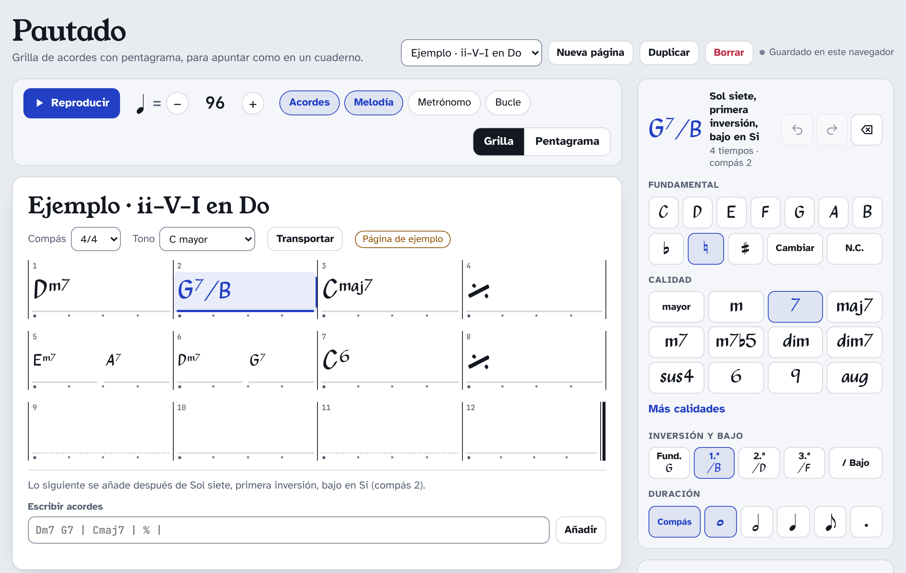
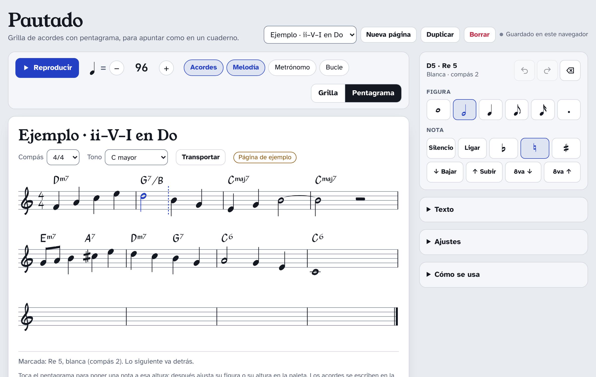
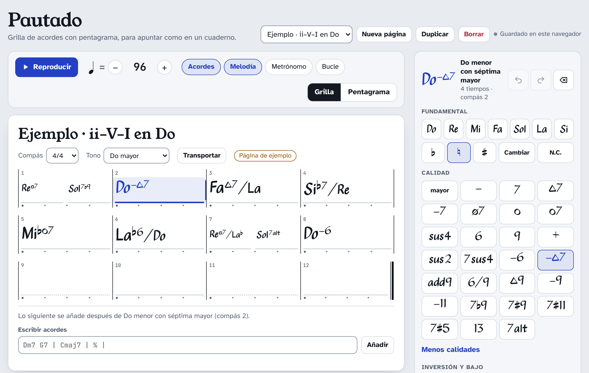
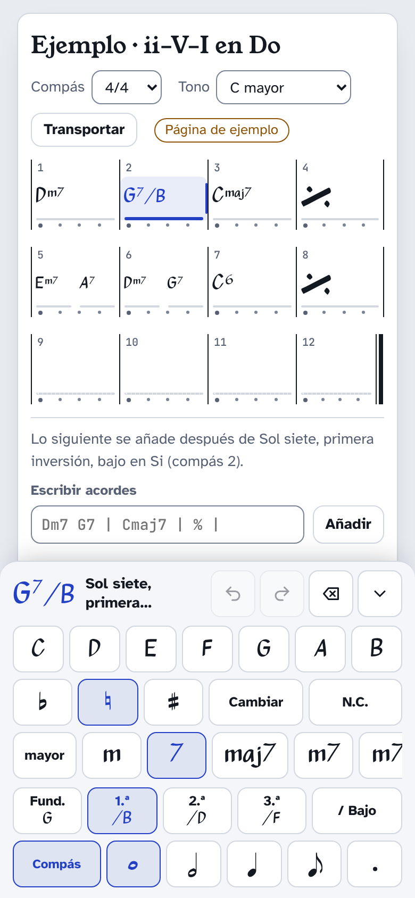
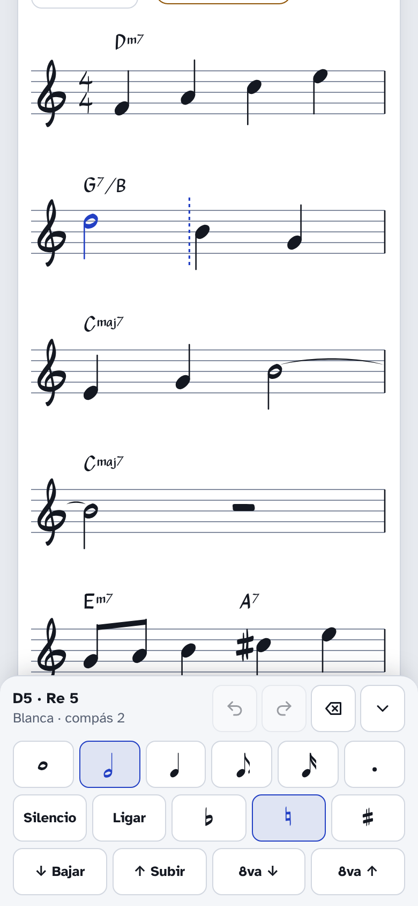

# DandeBook

**Pautado**: un cuaderno para apuntar grillas de acordes con cifrado americano y, cuando hace falta, la melodía en un pentagrama, como se haría a mano. Es el hermano de [DandEtudeDuR](https://github.com/rpp396/DandEtudeDuR) y comparte su manera de hacer las cosas: sin instalación ni compilación, todo local y privado, accesible y pensado también para el móvil.



## Qué incluye

- **Grilla de acordes:** compases de 4 en 4 (de 2 en 2 o de 1 en 1 en el móvil si el cifrado no cabe), varios acordes por compás y repetición del compás anterior con `%`.
- **Repeticiones y saltos:** barras de repetición con sus vueltas, casillas de 1.ª, 2.ª y 3.ª, Segno, Coda, Al Coda, Fine, D.C. y D.S., en la grilla y en el pentagrama, y la reproducción sigue la forma.
- **Cada acorde con su fundamental, calidad, inversión y duración:** 12 calidades a mano y 15 más (de la tríada mayor al 7alt), inversiones (1.ª, 2.ª, 3.ª) o cualquier otro bajo, y duración en compases, figuras o con puntillo.
- **Escritura rápida:** `Dm7 G7 | Cmaj7 | % |` y los acordes se reparten solos en los compases. Entiende muchas formas de escribir lo mismo: `Cmaj7`, `C7M`, `CΔ`, `Cm7b5`, `Cø`, `Sol7`, `Sib/Re`…
- **Pentagrama:** la melodía en clave de sol con el cifrado encima, al estilo de un *Real Book*: alturas, figuras de redonda a semicorchea, puntillos, silencios, ligaduras y alteraciones, con barras de corcheas, ligaduras entre compases y armadura.
- **Escucharlo:** acordes, melodía, metrónomo y bucle, con el compás que suena resaltado.
- **Transportar** a cualquiera de los 13 tonos mayores (de C a G♭ y F♯) con la ortografía correcta (B♭, no A♯), conservando las inversiones.
- **Estilos de cifrado:** claro (Cmaj7, Cm7♭5), jazz (C△7, Cø7) o latino (C7M, Cm7(♭5)), y nombres C D E o Do Re Mi.
- **Cuaderno:** hasta 300 páginas, guardado automático, deshacer y rehacer, y copia de cada página como texto para guardarla o pasarla.
- **Letra de cuaderno:** el cifrado y las notas usan Petaluma, la tipografía manuscrita de Steinberg.
- **Accesible y privada:** se puede usar entera con teclado y lector de pantalla, y no hace ninguna petición a otros sitios: todo, fuentes incluidas, va en el repositorio, y las páginas se quedan en tu navegador (ver [`SECURITY.md`](SECURITY.md)).

## Uso

Abre `index.html` en el navegador. Necesita a su lado `styles.css` y las carpetas `js/` y `fonts/`. Funciona abriéndolo directamente (`file://`) o sirviendo la carpeta con cualquier servidor web; no hay nada que instalar ni compilar. Las páginas se guardan en el navegador.

También se puede publicar como Artifact de claude.ai (ver más abajo); allí las páginas se guardan además en tu cuenta y te siguen de un dispositivo a otro.

## Cómo funciona

### La grilla

Cada fila tiene cuatro compases, con su número arriba y un punto por tiempo abajo. Los acordes se reparten el compás según lo que duran; si un acorde sigue del compás anterior, se ve una raya. Un compás igual al anterior se dibuja con el signo de repetición (se puede apagar en *Ajustes*).

En la paleta (a la derecha; en el móvil, fija abajo como un teclado):

- **Fundamental:** al tocar una nota se añade un acorde detrás del marcado. Con *Cambiar* activado, la nota cambia la fundamental del acorde marcado en lugar de añadir uno. *N.C.* añade un compás sin acorde.
- **♭ ♮ ♯:** alteran la fundamental (o el bajo, justo después de elegirlo).
- **Calidad:** mayor, m, 7, maj7, m7, m7♭5, dim, dim7, sus4, 6, 9 y aug; en *Más calidades*, sus2, 7sus4, m6, m(maj7), add9, 6/9, maj9, m9, m11, 7♭9, 7♯9, 7♯11, 7♯5, 13 y 7alt.
- **Inversión y bajo:** *Fund.*, *1.ª*, *2.ª* y *3.ª* ponen en el bajo la fundamental, la tercera, la quinta o la séptima, y cada botón muestra el bajo que da (G7 → G7/B, G7/D, G7/F). La inversión se mantiene al cambiar la calidad o la fundamental (C/E → Cm/E♭) y al transportar. *Bajo* pone cualquier otra nota en el bajo (C/D).
- **Duración:** compás entero, redonda, blanca, negra o corchea, y puntillo. Lo nuevo sale con la última duración elegida.
- **Puntillo:** es un interruptor. Mientras está activado, las figuras que eliges salen con puntillo (negra → negra con puntillo); al elegir un acorde o una nota, se pone como esté su figura. En **6/8 y 12/8 empieza activado**, porque el pulso es la negra con puntillo: los acordes nuevos duran un compás y las notas nuevas, una negra con puntillo. En los demás compases empieza desactivado.

Para cambiar un acorde, tócalo en la grilla y elige otra cosa en la paleta.

### Repeticiones y saltos

Debajo de la paleta, *Repeticiones y saltos* (plegable) pone las marcas de forma en el compás del acorde marcado, o en el compás que hayas tocado, aunque esté vacío:

- **‖:** y **:‖** abren y cierran una repetición; **×2** cambia las vueltas (de 2 a 8). Un «:‖» sin «‖:» vuelve al principio o al final de la repetición anterior.
- **1. 2. 3.** son las casillas: en cada vuelta se toca la de ese número. Varios compases seguidos con la misma casilla forman una.
- **Segno** y **Coda** van al principio del compás; **Al Coda**, **Fine**, **D.C.** y **D.S.** al final. *al Fine* y *al Coda* completan el salto.

Segno, Coda, Al Coda, Fine y el salto van una vez por página: ponerlos en otro compás los quita del anterior. Las marcas se quedan en su compás, y si metes o quitas compases enteros en medio de los acordes, las de detrás se mueven con ellos.

Al reproducir se sigue la forma con las convenciones habituales: después de un D.C. o D.S. no se repite y solo se toca la última casilla; entonces «Al Coda» salta a la Coda y Fine termina.

### Escribir acordes

Debajo de la grilla hay un campo para escribir varios acordes de una vez:

| Escribes | Resultado |
|---|---|
| `Dm7 G7` | dos acordes con la duración elegida en la paleta |
| `\| Dm7 G7 \| Cmaj7 \|` | cada `\|` cierra un compás y los acordes de un compás se lo reparten a partes iguales |
| `\| Cm7:3 F7:1 \|` | `:` indica los tiempos de cada acorde |
| `\| C \| % \|` | `%` repite el compás anterior |
| `\| C - \| G7 \|` | `-` alarga el acorde anterior |
| `N.C.` | sin acorde |
| `\|: Dm7 \| G7 x3 :\|` | repetición de tres vueltas (sin `x3`, dos) |
| `\| 1. C \| 2. F \|` | casillas |
| `\| Segno C \| G7 Al Coda \| F D.S. al Coda \| Coda C \|` | Segno, Al Coda, D.S. al Coda y Coda (también `𝄋`, `𝄌`, `Fine`, `D.C.`, `D.C. al Fine`) |

Acepta cifrado americano y latino (`Sol7`, `Sib/Re`, `Lam`) y las grafías habituales: `maj7`, `M7`, `7M`, `Δ`, `^`; `m`, `-`, `min`; `m7b5`, `ø`, `m7(b5)`; `dim`, `°`, `o`; `aug`, `+`; `sus`, `sus2`, `7sus4`; `6/9`, `add9`, `7(b9)`, `7#11`, `alt`…

### El pentagrama



Usa los mismos acordes que la grilla, encima de la melodía. Toca el pentagrama para poner una nota a esa altura (con el ratón se ve antes una nota de guía); la siguiente sale con la misma figura. Si tocas en un compás más adelante, el hueco se rellena con silencios. Con la nota marcada, la paleta cambia su figura, puntillo, silencio, ligadura, alteración, grado (*Bajar*, *Subir*) y octava. Con el ratón también se puede arrastrar una nota arriba o abajo.

La app escribe sola las barras de las corcheas y semicorcheas por pulso, las notas que cruzan la barra de compás (partidas y ligadas), las alteraciones según la armadura y lo que ya sonó en el compás, y reparte el ancho de cada compás para que el cifrado no se pise.

### Escuchar, transportar y el cuaderno

- **Reproducir** suena con lo elegido en *Acordes*, *Melodía*, *Metrónomo* y *Bucle*, siguiendo las repeticiones y los saltos; la grilla y el pentagrama marcan lo que suena. En bucle, los cambios se oyen en la vuelta siguiente.
- **Transportar** cambia el tono de la página y mueve acordes, bajos y melodía por el camino más corto. En el tritono (por ejemplo, de C a G♭ o F♯), la melodía sube o baja según cuál la deje más cerca del centro del pentagrama, así que ir y volver no la cambia de octava.
- **Páginas:** *Nueva página*, *Duplicar* y *Borrar* (pide confirmación). Cada cambio se guarda solo, y se puede deshacer hasta 100 pasos por página.
- **Texto:** *Copiar la página como texto* da algo así, que se puede pegar en *Texto para importar* para crear una página nueva:

  ```
  Pautado
  Título: Ejemplo · ii–V–I en Do
  Compás: 4/4 · Tempo: 96 · Tono: C
  | Dm7 | G7 | Cmaj7 | Cmaj7 |
  | Em7 A7 | Dm7 G7 | C6 | C6 |
  Melodía: F4q A4q C5q E5q | D5h B4q G4q | …
  ```

  Las repeticiones y los saltos se escriben dentro de los compases, como en *Escribir acordes*: `|: Segno Dm7 | 1. G7 x3 :| 2. C Fine |`.

  En la melodía: nota, alteración (`#`, `b`), octava (C4 es el do central) y figura (`w` redonda, `h` blanca, `q` negra, `e` corchea, `s` semicorchea), `.` para el puntillo y `~` para ligar con la siguiente; `rq` es un silencio de negra.

### Estilos de cifrado



En *Ajustes* se elige el estilo (claro, jazz o latino) y los nombres de las notas (C D E o Do Re Mi). Solo cambia cómo se ve: la página guarda lo mismo.

### En el móvil

<p>
  
  &nbsp;
  
</p>

La paleta queda fija abajo, como un teclado, y se pliega con la flecha. Todos los botones miden al menos 44 px. Si un acorde con bajo no cabe en su casilla, el bajo pasa a una segunda línea; si aun así no cabe, la grilla pone menos compases por fila. El pentagrama muestra dos compases por línea (uno si el cifrado lo pide).

### Teclado

Con la grilla o el pentagrama enfocados:

| Tecla | En la grilla | En el pentagrama |
|---|---|---|
| A–G | abre el campo de escribir con esa nota | añade esa nota, la más cercana a la anterior |
| ← → | acorde anterior o siguiente | nota anterior o siguiente |
| ↑ ↓ | sube o baja medio tono el acorde | sube o baja un grado (con Mayús, medio tono; con Ctrl, una octava) |
| 1 2 4 8 | redonda, blanca, negra, corchea | ídem, y 6 semicorchea |
| . | activa o quita el puntillo | activa o quita el puntillo |
| I | siguiente inversión | |
| / | elegir el bajo | |
| S, L | | silencio, ligadura |
| Retroceso | borra | borra |
| P | reproducir | reproducir |

Además: <kbd>Ctrl</kbd>+<kbd>Z</kbd> deshace, <kbd>Ctrl</kbd>+<kbd>Mayús</kbd>+<kbd>Z</kbd> o <kbd>Ctrl</kbd>+<kbd>Y</kbd> rehace y <kbd>Esc</kbd> detiene la reproducción.

**Accesibilidad:** la grilla se lee acorde por acorde («Compás 2: Sol siete, primera inversión, bajo en Si, 4 tiempos») y cada línea del pentagrama tiene su descripción en palabras; los cambios se anuncian al lector de pantalla. Respeta el movimiento reducido y los colores forzados.

## Pruebas

Hay una batería de pruebas de navegador en `tests/` (unas 380 comprobaciones: edición en la grilla y el pentagrama, lector de acordes, inversiones, tonos y puntillo en compás compuesto, repeticiones y saltos, transporte, texto, sonido, móvil a 390 y 320 px, guardado en la cuenta y datos hostiles). **No necesitan instalar nada:** usan Node 22 y el Chrome o Chromium del equipo, controlado directamente por el protocolo DevTools.

```
npm test                    # equivale a: node tests/run.mjs
node tests/run.mjs movil    # solo las suites cuyo nombre contiene «movil»
CHROME=/ruta/a/chrome npm test
```

En GitHub se ejecutan solas en cada *push* (`.github/workflows/tests.yml`).

## Archivo único para claude.ai

`node tools/artefacto.mjs` arma `dist/pautado.html`: la app entera en un archivo, con estilos, scripts y fuentes dentro, lista para publicarla como Artifact de claude.ai. `ARTEFACTO=1 npm test` pasa las pruebas a ese archivo. `node tools/capturas.mjs` rehace las capturas de este README.

## Fuentes

Todas con licencia [SIL Open Font License 1.1](https://openfontlicense.org); los textos de las licencias están en `fonts/`.

- **Pautado Cifra** y **Pautado Simbolos**: subconjuntos de [Petaluma Script y Petaluma](https://github.com/steinbergmedia/petaluma), © Steinberg Media Technologies GmbH. Al ser versiones recortadas, llevan otro nombre, como pide la licencia para el nombre reservado «Petaluma». Los glifos del pentagrama (`js/glifos.js`) son contornos de Petaluma convertidos a trazados SVG.
- **Atkinson Hyperlegible** (texto), **Young Serif** (títulos) y **JetBrains Mono** (números), las mismas de DandEtudeDuR.

Para el detalle técnico, consulta [`CLAUDE.md`](CLAUDE.md).
